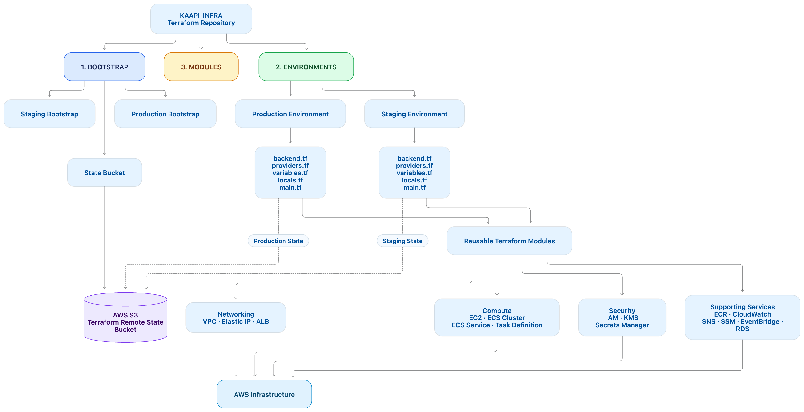

# kaapi-infra

Infrastructure as Code for Kaapi, written in Terraform. This repo is the single source of truth for everything Kaapi runs on AWS: networking (VPC, subnets, Elastic IPs), compute (ECS services behind an ALB, and EC2 instances), the RDS database, container images (ECR), configuration and secrets (SSM Parameter Store, Secrets Manager, KMS), scheduling (EventBridge), monitoring (CloudWatch) and access control (IAM).

Each environment (`staging`, `prod`, and any added later) is built from the same shared modules but has its own values, its own AWS profile and account guard, and its own remote state in S3. A change applied to one environment can never affect another.

> Make infra changes here and apply them with Terraform. Do not edit these resources by hand in the AWS console: Terraform will undo or conflict with manual changes on the next apply.

## Repository structure

| Folder | Purpose |
|---|---|
| `bootstrap/` | One-time setup per AWS account: the S3 bucket that holds Terraform state |
| `environments/` | One folder per environment (`staging`, `prod`) that wires the modules together with that environment's values |
| `modules/` | Reusable building blocks (VPC, ECS, ECR, RDS, CloudWatch, SNS, ...) shared by all environments |
| `docs/` | Diagrams and other documentation |

## Deploying (GitHub Actions)

Changes reach AWS only through GitHub Actions, and only after approval. Nobody needs AWS credentials to contribute.

| Step | Workflow | Who acts |
|---|---|---|
| Pull request | `pr-checks`: `terraform fmt -check` and `validate` for every environment (no AWS access) | Author, reviewers |
| Merge to `main` | `deploy-staging` starts and waits at **staging-plan** | — |
| Approve **staging-plan** | Plan is created and shown in the run summary | Staging approvers |
| Approve **staging-apply** | That exact saved plan is applied | Staging approvers, after reading the plan |
| Push a version tag (`v1.2.3`) on a `main` commit | `deploy-prod` starts and waits at **prod-plan** | Release manager |
| Approve **prod-plan**, then **prod-apply** | Same plan → review → apply flow for prod | Prod approvers |

- Several merges while staging waits for plan approval: each new run cancels the waiting one, so a single approval plans and applies everything merged so far.
- An apply is never cancelled midway. If state changed after a plan was made, Terraform refuses that plan; re-run the workflow to plan again.
- If a plan has no changes, the apply step is skipped.
- Only tags like `v1.2.3` deploy prod, and only when the tag points to a commit on `main`. Tags such as `v1.2.3-rc1` are ignored.
- Staging can also be re-run from **Actions → deploy-staging → Run workflow**.
